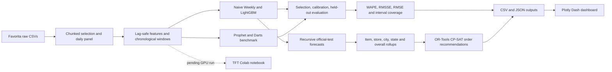

# DS-02: Nationwide Demand Forecasting and Inventory Optimization

**Portfolio project · Retail time series · Inventory decision support**

This project builds a multi-store daily demand forecasting and replenishment workflow using the Corporación Favorita Kaggle grocery-sales data. It combines chronological model evaluation, coherent store and product rollups, empirical prediction intervals, OR-Tools inventory optimization, and a six-tab Plotly Dash dashboard.

## Author & Contact

**Misbaudeen Abdurrahman**

- **GitHub:** [ayobamiiiii](https://github.com/ayobamiiiii)
- **Project Repository:** [retail-demand-forecasting](https://github.com/ayobamiiiii/retail-demand-forecasting)
- **LinkedIn:** [Misbaudeen Abdurrahman](https://www.linkedin.com/in/misbaudeen-abdurrahman-67723121a)

> **Dataset scope:** The code is organized around a nationwide retail planning problem, but the verified run is a bounded sample of Favorita in Ecuador: 39 items, 116 item-store series, and three stores across three provinces. It is not a full-network or nationwide evaluation, and the data is Favorita—not Walmart M5.

## 1. Project overview

Retail planners need reliable demand estimates to decide what to replenish, where, and in what quantity. This project demonstrates an end-to-end workflow that forecasts daily item-store unit sales, evaluates several forecasting approaches on chronological holdouts, aggregates forecasts through product and geographic levels, and recommends inventory orders under stated holding-cost, shortage-cost, and capacity assumptions.

The current run selected LightGBM on an earlier WAPE selection window. Naive Weekly, LightGBM, Prophet, and Darts Regression completed evaluation. A Temporal Fusion Transformer (TFT) Colab notebook and data export are prepared, but **TFT is pending GPU training and has no reported score**.

## 2. Business problem

Demand changes by product, store, weekday, season, promotion, and local event. Under-forecasting can lead to stockouts and missed sales; over-forecasting ties up working capital, consumes storage, and raises holding or waste risk. Forecast error also makes replenishment decisions harder when existing inventory, order limits, and service targets must be considered together.

This project connects a demand forecast to a constrained order recommendation. The recommendations are decision-support estimates under explicit proxy costs; they are not a record of actual purchases, realized stock availability, or realized financial savings.

## 3. Dataset

The project uses the [Corporación Favorita Grocery Sales Forecasting Kaggle competition](https://www.kaggle.com/c/favorita-grocery-sales-forecasting/overview). Favorita is an Ecuadorian grocery retailer. The project uses the supplied Favorita files and does not use Walmart M5 data.

| File | Relevant fields | Use |
|---|---|---|
| `train.csv` | `date`, `store_nbr`, `item_nbr`, `unit_sales`, `onpromotion` | Historical daily sales target and promotion flag |
| `test.csv` | `id`, `date`, `store_nbr`, `item_nbr`, `onpromotion` | Forecast horizon and known promotion input |
| `items.csv` | `item_nbr`, `family`, `class`, `perishable` | Product metadata |
| `stores.csv` | `store_nbr`, `city`, `state`, `type`, `cluster` | Store and geographic metadata |
| `oil.csv` | `date`, `dcoilwtico` | Oil price series |
| `holidays_events.csv` | `date`, `type`, `locale`, `locale_name`, `description`, `transferred` | Holiday/event indicators |
| `transactions.csv` | `date`, `store_nbr`, `transactions` | Store-level transaction counts |
| `sample_submission.csv` | `id`, `unit_sales` | Kaggle submission template; not a training target |

The active pipeline reads the large training CSV in chunks, ranks items by observed unit sales, and filters to the configured stores and item sample. It aggregates duplicate date-store-item sales, creates a daily series grid, fills absent sales days with zero, and joins metadata and auxiliary series. Sales are clipped at zero. Promotion values are normalized to Boolean. Oil is forward-filled with a fallback for leading missing values; transactions are forward-filled by store. Model features include target lags (1, 7, 14, and 28 days), prior-sales rolling means and standard deviation, calendar fields, promotions, holidays, lagged oil and transactions, and item/store metadata. Oil and transaction predictors use prior-day values; recursive forecasts feed predictions back into lag features.

The current processed panel covers 2013-01-02–2017-08-15: 195,692 rows, 116 item-store series, 39 items, and three stores in three provinces. The full raw data and processed panel are intentionally excluded from Git.

## 4. Technical architecture



The active command-line pipeline is `src/pipeline.py`. Supporting modules handle Favorita ingestion, feature generation, model comparison, metrics, interval construction, hierarchy rollups, and inventory optimization. `src/data/m5.py` is a retained M5 data helper; it is not the dataset used for this Favorita run.

## 5. Forecasting models

| Model | Implementation | Current status |
|---|---|---|
| Naive Weekly | Previous-week (`lag_7`) demand baseline | Evaluated |
| LightGBM | Gradient-boosted regression using lag, rolling, calendar, promotion, holiday, lagged auxiliary, and metadata features; recursively forecasts the official test dates | Evaluated; best WAPE in both reported comparisons |
| Prophet | Per-series Prophet forecast with weekly seasonality and yearly seasonality when sufficient history exists | Evaluated in the common-sample comparison |
| Darts Regression | Darts `RegressionModel` with 28 autoregressive lags and a shared Ridge estimator | Evaluated in the common-sample comparison; Darts 0.41 emitted an upstream deprecation warning for this API |
| Temporal Fusion Transformer (TFT) | PyTorch Forecasting/Lightning notebook with `TimeSeriesDataSet`, `QuantileLoss`, early stopping, and a compact Colab GPU configuration | **PENDING GPU TRAINING. No TFT metrics or predictions are available.** |

The completed Prophet/Darts comparison is deliberately limited to six common series to bound runtime. TFT is not counted as an executed model until a Colab run successfully writes predictions and a success execution report.

## 6. Model evaluation

- **WAPE** is total absolute error divided by total absolute actual demand. Lower is better; it is shown as a percentage.
- **RMSSE** is the square root of forecast mean squared error divided by that series’ mean squared one-step training difference; the project reports the mean across series. Lower is better.
- **RMSE** is the square root of mean squared error in sales units per day. Lower is better and is sensitive to high-volume series.

### Primary 116-series rolling validation

These are the active baseline metrics for 116 item-store series and 3,248 observations over 2017-07-19–2017-08-15. They are one-day-ahead rolling predictions: each validation date can use actual history through the prior date. Model selection used the earlier 2017-06-21–2017-07-04 window; interval calibration used 2017-07-05–2017-07-18.

| Model | WAPE | RMSSE (mean) | RMSE |
|---|---:|---:|---:|
| Naive Weekly | 41.1774% | 0.704982 | 22.850307 |
| LightGBM | 29.9650% | 0.683098 | 15.713903 |

### Common-sample comparison

This separate comparison evaluates the same six series and 168 held-out observations for all completed models, over 2017-07-19–2017-08-15. Model selection uses 2017-06-21–2017-07-04; calibration uses 2017-07-05–2017-07-18. These scores should not be compared directly with the 116-series table because the sample differs.

| Model | WAPE | RMSSE (mean) | RMSE |
|---|---:|---:|---:|
| Naive Weekly | 24.7320% | 0.772054 | 51.084838 |
| LightGBM | 15.6490% | 0.470417 | 29.465924 |
| Prophet | 20.9164% | 0.620779 | 39.298949 |
| Darts Regression | 18.3903% | 0.552134 | 35.399453 |

LightGBM had the lowest WAPE, RMSSE, and RMSE in both displayed comparisons. On the primary validation, its WAPE was 29.97% versus 41.18% for Naive Weekly. These are held-out results for the configured sample, not full-dataset or production estimates.

### Prediction intervals

The pipeline calibrates a symmetric, constant-width interval using a quantile of absolute residuals from the separate calibration window. Primary nominal 90% interval coverage was **90.12%** on the later 3,248-row holdout. The common-sample nominal 90% interval coverage was **93.45%** on 168 rows. This is empirical marginal coverage; it is not a conditional guarantee for every item, store, or horizon.

## 7. Inventory optimization

`src/optimization/orders.py` uses OR-Tools CP-SAT to choose an integer order quantity that minimizes weighted expected holding and shortage costs under three demand scenarios: low, median, and high. Scenario weights are 25%, 50%, and 25%. The order is bounded by `max_order` and by remaining capacity under `max_inventory`; on-hand inventory enters the available-stock and cost calculations. Each generated recommendation includes the solver status and estimated ending inventory, shortage, holding cost, stockout cost, and objective cost.

Safety stock is `ceil(z × demand_std)`, where `z` is the normal quantile for the configured service level. Forecast uncertainty is estimated from calibration residuals and scaled by the square root of the forecast horizon, assuming independent daily errors. Defaults are a 90% service level, maximum order of 2,000 units, and maximum inventory of 5,000 units.

Favorita does not supply on-hand stock or actual carrying and shortage costs. The current run assumes zero on-hand inventory unless an optional `item_nbr,store_nbr,on_hand` CSV is configured. It uses proxy costs of 0.20 per leftover unit and 2.00 per unmet unit, in generic cost units (not currency). These assumptions are configurable in `config/default.yaml`.

Current generated run, 110 item-store recommendations:

| Measure | Result |
|---|---:|
| Solver status | 110/110 `OPTIMAL` |
| Recommended units | 56,580 |
| Estimated holding cost | 1,108.50 cost units |
| Estimated stockout cost | 5,020.00 cost units |
| Optimized objective cost | 6,128.50 cost units |
| Existing order-up-to policy | 85,375 units; 11,887.50 modeled cost units |
| Modeled cost reduction | 48.45% under the configured scenarios and proxy costs |

The 48.45% figure is a modeled comparison against the existing policy under the same scenario assumptions. It is **not realized business savings**. Five recommendations hit the order cap and retain modeled shortage.

## 8. Interactive dashboard

The Plotly Dash app provides six tabs, with store, item, and date filters:

1. **Executive Overview** — forecast totals and headline store/order counts.
2. **Sales Trends** — historical sales trend for the selected products and stores.
3. **Demand Forecasts** — daily forecasts with lower and upper empirical interval bounds.
4. **Model Performance** — dynamic model metrics, per-metric leaders, evaluation scope, and held-out prediction verification.
5. **Inventory Optimization** — order and cost KPIs, demand/inventory/order chart, policy comparison, and recommendation table.
6. **Store and Item Analysis** — highest forecast store-item combinations for the selected filters.

Run the forecasting pipeline first so generated outputs exist, then start the dashboard:

```bash
python app.py
```

Open the local URL printed by Dash (normally `http://127.0.0.1:8050`). The automated dashboard checks exercise the home route and all six callbacks; they are not browser-based visual regression tests.

## 9. Technology stack

Python 3.10+; pandas and NumPy for ingestion and feature preparation; scikit-learn and LightGBM for tabular forecasting; Prophet for per-series forecasting; Darts with Ridge for autoregressive regression; PyTorch, Lightning, and PyTorch Forecasting for the pending TFT Colab notebook; OR-Tools CP-SAT for constrained inventory decisions; Plotly and Dash for interactive visualization; Matplotlib for a generated sales trend; and PyYAML for configuration. Exact dependency ranges are in [`requirements.txt`](requirements.txt).

## 10. Project structure

```text
.
├── README.md
├── requirements.txt
├── app.py                         # Dash entry point
├── config/
│   └── default.yaml
├── dashboard/
│   └── app.py
├── data/
│   └── processed/.gitkeep         # raw and processed datasets are Git-ignored
├── docs/
├── notebooks/
│   ├── tft_colab.ipynb            # TFT handoff; training pending
│   └── tft_dataset_manifest.json  # series IDs and split metadata
├── outputs/
│   └── final_audit_report.md      # detailed run-specific audit
├── src/
│   ├── data/                      # Favorita and retained M5 helper
│   ├── evaluation/                # metrics and common-sample comparison
│   ├── features/                  # lag-safe Favorita feature builder
│   ├── forecasting/               # hierarchy and intervals
│   ├── models/                    # baselines, LightGBM, Prophet, Darts, TFT
│   ├── optimization/              # OR-Tools order model
│   └── pipeline.py
└── tests/
    ├── test_dashboard_tabs.py
    ├── test_favorita_hierarchy.py
    ├── test_favorita_lagged_covariates.py
    └── test_inventory_optimization.py
```

Raw CSVs, the processed panel, the TFT export CSV, generated forecasts/metrics, fitted model files, and virtual environments are excluded by `.gitignore`. The final audit report is the explicit small generated-output exception.

## 11. Installation and execution

Use Python 3.10 or newer with working SSL support. The recorded project run used macOS arm64 and Python 3.12.7. The commands below work in macOS and Linux shells.

```bash
# From the project root after cloning or downloading the repository:
python3 -c 'import ssl; print(ssl.OPENSSL_VERSION)'
python3 -m venv .venv
source .venv/bin/activate
python -m pip install --upgrade pip
python -m pip install -r requirements.txt
python -m pip check
```

Download the Corporación Favorita competition files from Kaggle, accept the competition terms, and extract the required CSVs into `data/raw/favorita/`:

```text
train.csv  test.csv  items.csv  stores.csv
oil.csv  holidays_events.csv  transactions.csv
```

Run the full pipeline, then the dashboard:

```bash
python -m src.pipeline --config config/default.yaml
python app.py
```

The pipeline writes forecasts, validation predictions, metrics, hierarchy rollups, inventory recommendations, and a LightGBM artifact under `outputs/`. Configure sample size, stores, validation periods, model comparison windows, and inventory assumptions in `config/default.yaml`. For the optional TFT handoff, enable a Colab T4 GPU, upload `notebooks/tft_colab.ipynb`, and provide the locally generated `data/processed/tft_favorita_116_series.csv` when prompted. TFT results remain pending until that notebook finishes successfully.

## 12. Testing and validation

The last recorded full run reported **16 tests passed**: 10 inventory optimization tests, three lagged-covariate/future-origin tests, one hierarchy test, and two dashboard route/callback tests. The final audit also records successful compilation, `pip check`, solver statuses, and interval coverage.

Run the project checks locally:

```bash
python -m unittest discover -s tests -v
python -m compileall -q src dashboard app.py tests
python -m pip check
```

See [`outputs/final_audit_report.md`](outputs/final_audit_report.md) for the detailed run-specific evidence and limitations.

## 13. Limitations and future improvements

- **TFT is pending GPU training.** The notebook and exact 116-series export are prepared; no TFT score is available. Run the notebook on Colab T4, confirm its execution report says `success`, then compare only its saved held-out predictions.
- The model results cover 116 item-store series from 39 items and three stores, not all Favorita stores or all product-item series. The completed Prophet/Darts comparison uses only six common series.
- The available data is Favorita in Ecuador; Walmart M5 data and M5 evaluation are not part of this project.
- Favorita does not provide on-hand inventory, real purchase costs, holding costs, shortage penalties, or realized lost sales. Current replenishment and savings figures depend on configurable assumptions.
- The interval is a constant-width empirical residual interval. Broader rolling-origin calibration and segment-level coverage checks would strengthen its reliability assessment.
- The Darts 0.41 `RegressionModel` used in the executed comparison is deprecated upstream; a future dependency upgrade may require the Darts `SKLearnModel` API.
- Production extensions could add full-network training, store/item cross-validation, stock and lead-time data, service-level monitoring, forecast drift checks, CI, and automated retraining.

This repository presents an applied forecasting and optimization case study. The implementation and results should be read in the context of the bounded Favorita sample and the documented inventory assumptions.
