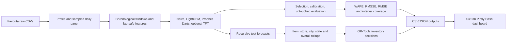

# Favorita Retail Forecasting and Inventory Planning

This project builds daily item-by-store demand forecasts from the Corporación Favorita grocery sales data, evaluates them on chronological holdouts, produces coherent hierarchy rollups and prediction intervals, and uses OR-Tools to recommend replenishment quantities. The Plotly Dash app presents forecasts, model results, and inventory decisions. It uses the existing workspace and writes generated artifacts beneath `outputs/`.

## Problem and data

The goal is to predict unit sales for each item and store and translate the demand estimate into an inventory order that balances holding and shortage costs. The active dataset is Favorita, stored under `data/raw/favorita/`; it includes train/test sales, item and store metadata, promotions, holidays, oil prices, and transactions. The supplied data has no on-hand stock or actual holding/stockout costs. The pipeline streams the large training file and limits modeling to configured top-selling items and stores. It does not treat synthetic data as observed results.

## Architecture



## Technology

Python, pandas, NumPy, scikit-learn, LightGBM, Prophet, Darts, PyTorch Forecasting/Lightning (TFT attempt), OR-Tools CP-SAT, Plotly, and Dash. `requirements.txt` pins compatible major-version ranges. The verified runtime in this workspace is macOS arm64 with Python 3.12.7. MPS availability and model execution status are recorded in generated metrics; installed libraries alone are not counted as an executed model.

## Installation

Use Python 3.10 or newer with SSL support. Confirm it before installing dependencies:

```bash
python3 -c 'import ssl; print(ssl.OPENSSL_VERSION)'
python3 -m venv .venv
source .venv/bin/activate
python -m pip install --upgrade pip
python -m pip install -r requirements.txt
python -m pip check
```

Put the extracted Favorita CSV files in `data/raw/favorita/`. Raw data, processed panels, generated outputs, virtual environments, credentials, and model checkpoints are excluded by `.gitignore`.

## Run

```bash
python -m src.pipeline --config config/default.yaml
python app.py
```

Open the local Dash URL printed by `app.py`. The six tabs are Executive Overview, Sales Trends, Demand Forecasts, Model Performance, Inventory Optimization, and Store and Item Analysis. Screenshots can be captured from the running dashboard; no screenshots are committed because outputs depend on the local dataset and run.

The main pipeline writes forecast and validation CSVs, metrics JSON, hierarchy rollups, inventory recommendations, and a LightGBM model under `outputs/`. `config/default.yaml` controls stores, sample size, validation horizon, benchmark windows, inventory costs, service level, and order bounds. The expanded model benchmark uses a common configurable series sample with three disjoint windows: early model selection, residual calibration, and a final untouched evaluation period. Model-specific execution failures are recorded in `outputs/metrics/model_comparison.json` when the benchmark completes.

## Model evaluation

Metrics are computed from held-out predictions, never hard-coded. WAPE is aggregate absolute error divided by aggregate actual sales; RMSSE is computed per series and averaged; RMSE is in units/day. The performance dashboard loads the generated metric JSON and benchmark predictions dynamically. It displays successful models on the same series and dates, highlights per-metric leaders, and recomputes metrics against the saved actuals and pre-evaluation history.

The active baseline validation run currently recorded in `outputs/metrics/model_metrics.json` uses 116 item-store series and 3,248 observations over 2017-07-19 through 2017-08-15:

| Model | WAPE | RMSSE | RMSE |
|---|---:|---:|---:|
| Naive Weekly | 41.18% | 0.704982 | 22.850307 |
| LightGBM | 29.97% | 0.683098 | 15.713903 |

These are the active pipeline's one-day-ahead metrics, distinct from the common-sample multi-day comparison. The final audit report records fresh execution metrics and status for Prophet, Darts, and TFT. Prophet is evaluated as a per-series time-series model; Darts is used for a global autoregressive regression forecaster. TFT uses a small PyTorch Forecasting configuration and CPU when MPS is unavailable. Any dependency, compatibility, or runtime failure is reported instead of being represented as a score.

The executed common-sample comparison uses six item-store series, 84 observations per selection/calibration block, and 168 observations in the final evaluation block. All four executed models use the same series and dates:

| Model | WAPE | RMSSE | RMSE |
|---|---:|---:|---:|
| Naive Weekly | 24.73% | 0.772054 | 51.084838 |
| LightGBM | 15.65% | 0.470417 | 29.465924 |
| Prophet | 20.92% | 0.620779 | 39.298949 |
| Darts Regression | 18.39% | 0.552134 | 35.399453 |

The common-sample benchmark selected LightGBM on WAPE in the separate 2017-06-21–2017-07-04 selection window. Its residual interval was calibrated on 2017-07-05–2017-07-18 and reached 93.45% coverage on the untouched 2017-07-19–2017-08-15 evaluation period (nominal 90%). TFT dependencies import, but its one-epoch/two-batch CPU attempt did not return during the audit run; it is excluded from scored model results. This Mac's MPS backend reports unavailable, and no dependency exception was observed.

## Prediction intervals

The benchmark reserves separate chronological blocks for model selection, absolute-residual calibration, and untouched evaluation, where history permits. The calibrated constant-width interval is an empirical marginal interval, and coverage on the final period is reported. This is not a rolling conditional conformal guarantee and may have uneven coverage across series and forecast horizons. The operational forecast pipeline retains a main validation-period metric view; inspect the audit and metric metadata to distinguish protocol results.

## Inventory optimization

The OR-Tools CP-SAT model minimizes expected holding and shortage costs over low/median/high demand scenarios with 25%/50%/25% weights. It includes starting on-hand inventory, bounded order quantities, and maximum inventory capacity. Safety stock uses a documented 90% service level and calibration residual standard deviation scaled by the square root of the horizon (independent daily error approximation). The dashboard compares this objective with the existing order-up-to policy and reports order units, expected holding cost, expected stockout cost, and total objective cost.

Default holding cost (0.20 per leftover unit) and stockout cost (2.00 per unmet unit) are transparent proxy cost units, not currency or observed Favorita economics. Since no stock-on-hand file is included, default on-hand is zero. Provide an optional CSV with `item_nbr,store_nbr,on_hand` and set `inventory.on_hand_file` in the config for local stock. Replace the assumptions with business values before operational use.

## Assumptions and limitations

- Favorita is the available alternative dataset; the workspace does not include the assignment's M5 files.
- The default sample is bounded to the configured stores and top-selling item set; results do not represent the full dataset.
- Same-day sales and future store transactions/oil values are excluded from feature inputs; transaction and oil predictors use lagged or frozen forecast-origin values.
- Official future promotions and calendar events may be used because they are known inputs.
- Inventory inputs and costs are missing from Favorita and use explicit configurable assumptions.
- TFT may be slow on CPU because this Mac reports MPS unavailable; it is not counted as evaluated unless its training and prediction complete.
- Prophet's per-series fit and the Darts regression model increase runtime on larger samples; use `model_comparison.series_limit` to manage compute.
- Prediction interval coverage is sample-dependent and does not imply a guarantee for each product or horizon.

## Tests and audit

Run the full available test suite and dependency check:

```bash
python -m unittest discover -s tests -v
python -m compileall -q src dashboard app.py tests
python -m pip check
```

`outputs/final_audit_report.md` is the run-specific checklist, including actual model status and scores, test output, and known limitations. Generated data and metrics are intentionally ignored by Git; the report can be included separately when preparing a dataset-specific submission.
