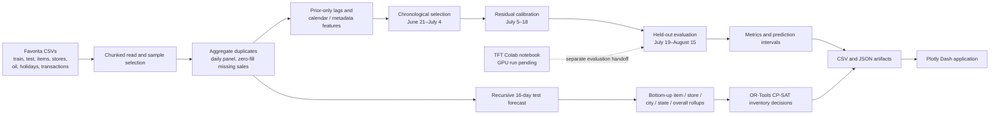

# Technical Architecture

## Scope

The executable pipeline uses Corporación Favorita data. The verified run covers 39 selected items, stores 1, 24, and 37, 116 item-store series, and three Ecuadorian provinces. It is a bounded sample, not a full nationwide deployment.

## End-to-end workflow



## Components and responsibilities

| Component | Repository path | Responsibility |
|---|---|---|
| Configuration | `config/default.yaml` | Sample size, stores, validation windows, benchmark scope, interval level, inventory costs and bounds |
| Favorita ingestion | `src/data/favorita.py` | Read source CSVs in chunks, select items/stores, aggregate duplicate rows, join metadata, build daily panel |
| Features | `src/features/favorita.py`, `src/data/favorita.py` | Sales lags and rolling statistics; calendar, promotion, holiday, product/store and prior-day auxiliary features |
| Core pipeline | `src/pipeline.py` | Chronological baseline/LightGBM evaluation, interval calibration, recursive test forecasting, rollups and inventory recommendations |
| Model benchmark | `src/evaluation/model_comparison.py`, `src/models/` | Common-sample Naive Weekly, LightGBM, Prophet and Darts Regression comparison; optional TFT path is not scored |
| Metrics and intervals | `src/evaluation/metrics.py`, `src/forecasting/intervals.py` | WAPE, RMSSE, RMSE, absolute-residual interval radius and empirical coverage |
| Hierarchy | `src/forecasting/hierarchy.py` | Bottom-up aggregation to item-store, item, store, city, state and overall levels |
| Inventory | `src/optimization/orders.py` | CP-SAT order quantity minimizing weighted holding and shortage cost |
| Dashboard | `app.py`, `dashboard/app.py` | Load generated CSV/JSON artifacts and serve six interactive Dash tabs |
| TFT handoff | `notebooks/tft_colab.ipynb`, `notebooks/tft_dataset_manifest.json` | Colab GPU training and same-period validation, not yet completed |

## Forecast and evaluation flow

The primary Naive Weekly and LightGBM run scores 116 series and 3,248 series-day observations. Training history ends before the validation start. It uses rolling one-day-ahead predictions, where actual history through the previous day is available. Model selection is on June 21–July 4; calibration is July 5–18; the later July 19–August 15 period is the scored holdout.

The four-model comparison uses six common series and 168 held-out observations. It uses the same chronological blocks. The dashboard's Model Performance tab reads this six-series comparison when its JSON exists; it does not show the 116-series primary table.

Intervals are symmetric, constant-width bands. Their radius is an absolute-residual quantile computed on the separate calibration block. Coverage is then measured on the later evaluation block. This is empirical marginal coverage, not a conditional guarantee per item or store.

The official test forecast is recursive across 16 dates, August 16–31, 2017. The current output contains 1,760 forecast rows for 110 item-store pairs. Later model inputs use generated predictions for sales lags. Official-test promotions and holiday calendar flags are known inputs; oil and transaction features are frozen at the last forecast-origin observation.

## Sample-selection isolation

Item IDs are ranked using nonnegative `unit_sales` strictly before the exclusive sample-selection cutoff. The cutoff is derived from the official test start and configured validation windows, then set to the earliest relevant date. For this run it is 2017-06-21, before the June 21–July 4 selection window, July 5–18 calibration window, and July 19–August 15 scored holdout. The common-series benchmark also ranks item-store series only on dates before its selection window. A manifest records the cutoff and selected item IDs; a cache without matching provenance is rebuilt. Automated tests verify post-cutoff sales cannot change either ranking.

## Inventory decision flow

For each forecast item-store pair, the pipeline estimates the horizon mean and calibration-residual uncertainty. It applies a normal-quantile safety buffer at the configured 90% service level, with horizon uncertainty scaled by the square root of the forecast horizon. CP-SAT minimizes expected holding and shortage cost over low, median, and high demand scenarios weighted 25% / 50% / 25%. Order quantity is a bounded integer, constrained by the order cap and remaining inventory capacity.

Current assumptions are zero on-hand units, 0.20 cost units per excess unit, and 2.00 cost units per unmet unit. Favorita supplies no store inventory or actual carrying/shortage economics. These are modeled cost comparisons, not realized savings.

## Local run

From the project root, after creating the documented virtual environment and installing `requirements.txt`:

```bash
python -m src.pipeline --config config/default.yaml
python app.py
```

The pipeline expects the required Favorita CSV files under `data/raw/favorita/`. Generated outputs are written under `outputs/`; datasets and most generated artifacts are Git-ignored.
